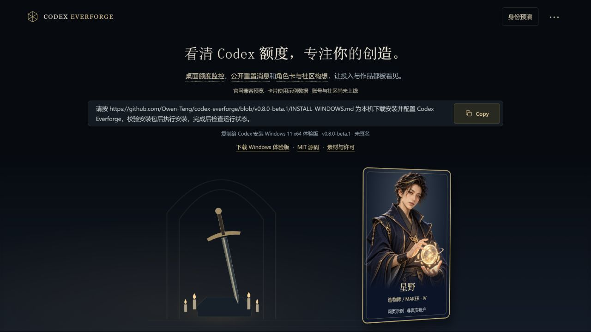
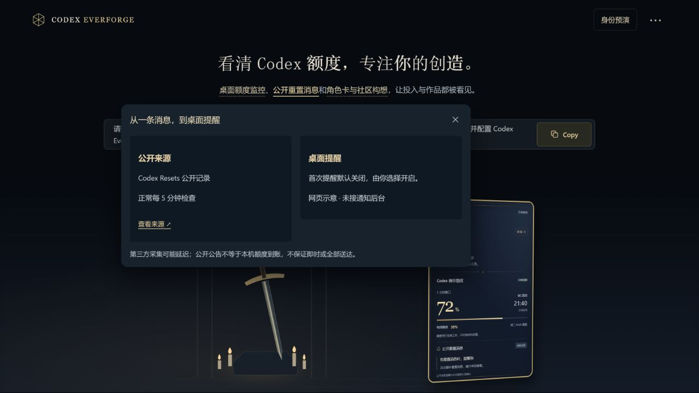

# Codex Everforge

**在 Windows 任务栏查看 Codex 额度，接收公开重置消息。**
一眼查看剩余额度，点击打开桌面浮窗；查看公开重置动态，并通过来源链接了解原文。

[下载 Windows 11 x64 体验版](https://github.com/Owen-Teng/codex-everforge/releases/tag/v0.8.0-beta.1) · [安装说明](INSTALL-WINDOWS.md) · [功能状态](FEATURES.md) · [English](README.en.md)

Windows 11 x64 · v0.8.0-beta.1 · 未签名预发布版 · 独立社区项目，与 OpenAI 无隶属或背书关系。

[打开官网兼容预览](https://owen-teng.github.io/codex-everforge/) · [官网源码与功能](docs/README.md)

> 官网是可操作的展示候选，使用自有场景与示例数据；不是账户后台或联网社区。

*线上官网实拍，使用示例角色与数据。点击进入交互预览；不是安装后桌面实机截图。*

查看角色卡、消息说明与原生菜单

| 网页角色卡示例 | 网页公开消息功能说明 |
| --- | --- |
|  |  |

下面是 Windows 原生菜单的隔离渲染检查，展示已提供的深蓝金色主题；不是安装后实机截图。

## 把额度留在视线里

反复打开设置查额度，会打断手头的工作。Everforge把图标和数字放在任务栏，详细信息放进点击即开的浮窗。公开重置消息和本机额度变化分别展示：看到公告，不等于你的账号额度已经恢复。

- **任务栏额度：**通过你自己已登录的官方 Codex CLI 读取本机额度。
- **公开重置消息：**查看观测、摘要与来源链接，自选是否开启提醒。
- **三主题一致体验：**浮窗与原生右键菜单跟随所选主题。
- **本机偏好：**保存主题、简介和可空作品链接，可选择随 Codex 启动。

## 开始使用

1. 从同一发行页下载 Windows x64 ZIP 和 `SHA256SUMS.txt`。
2. 校验ZIP、解压并运行 `INSTALL.cmd`。需要 Windows 11 x64、.NET Framework 4.x、WebView2 Runtime，以及本人已登录的官方 Codex CLI。
3. 打开工具，在设置中选择消息提醒及随 Codex 启动。消息提醒默认关闭；首次开启时，已有消息作为静默基线。

无需 X 开发者账号或密钥。安装包尚未代码签名，安装前请核对发行来源和校验值。升级保留设置和回退方法见[安装说明](INSTALL-WINDOWS.md)。

**也可以把这句话发给自己的 Codex：**

> 请从 https://github.com/Owen-Teng/codex-everforge/releases/tag/v0.8.0-beta.1 安装 Codex Everforge。先读版本说明，下载 Windows x64 ZIP 及同版本 SHA256SUMS.txt，校验后解压，先运行 scripts/install-n54.ps1 -Action Check，通过后再安装并保留设置；若同版文件已完全匹配，只检查，不重复安装。需要登录Codex时让我本人完成，不读取或上传认证内容。最后告诉我安装版本及仍需本人处理的事项。

## 功能状态

| 能力 | 当前状态 |
| --- | --- |
| 任务栏额度、桌面浮窗 | Windows体验版可用 |
| 公开重置消息 | 第三方来源，正常每5分钟检查 |
| 三主题及一致右键菜单 | 已提供，本机菜单观感已获确认 |
| 简介、作品链接与偏好 | 本机保存，无需注册 |
| 云账号、OAuth、付费会员 | 尚未上线 |
| 在线社区与盲比 | 尚未上线；官网相关展示使用示例数据 |
| 云端自动升级 | 尚未上线；升级使用发布的安装包 |
| 其他操作系统 | 本次未提供 |

## 消息时效与体验版限制

默认来源为 [Codex Resets](https://codex-resets.com/)，每5分钟检查一次。上游采集、缓存、服务中断、网络和电脑睡眠/离线都可能增加延迟或造成漏报。这不是官方X实时流，也不是作者完整时间线，不能保证每次重置必达。公开包不包含AIHOT内部配置或原文缓存。

本机额度回升还有两项已知缺口：未知错误或部分读数可能清掉前后比较基线；回升提醒尚无独立可靠队列，可能被来源通知路径覆盖。本版不声称已修复全部漏报。

当前实机验证限一台Windows电脑；第二台电脑、实际睡眠恢复、多屏与未来自然新消息仍待验证。原生菜单配图为隔离WinForms渲染检查，除非另有明确标注，不作为安装后实机截图。

## 隐私与开发

额度通过本机CLI读取，不把认证文件、API密钥或个人额度上传社区。公开消息检查会访问第三方站点。界面资料和偏好保存在自己的电脑上。

源码构建需要Windows、Go 1.26.x及.NET Framework 4.x C#编译器，运行 `powershell -NoProfile -File scripts/build.ps1`，见[构建脚本](scripts/build.ps1)。源码及文档采用 [MIT](LICENSE)，美术与品牌另见[素材许可](ASSETS-LICENSE.md)和[第三方声明](THIRD_PARTY_NOTICES.md)。[反馈问题](https://github.com/Owen-Teng/codex-everforge/issues)时请注明版本和复现步骤，并移除截图、日志里的私人信息。
