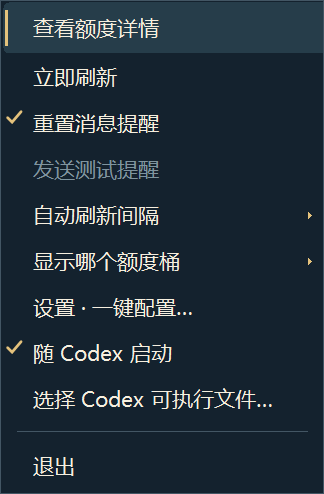

# Codex Everforge

**把 Codex 剩余额度放到 Windows 任务栏，少一点来回检查。**

A small Windows quota companion for Codex, with public reset notices and a creator-card interface.

Independent community project. Not affiliated with or endorsed by OpenAI.

## Windows 体验版

- 任务栏「图标＋数字」，无需反复打开额度设置。
- 自动读取本机 Codex 额度；点击打开右下角浮窗。
- 公开重置观测与原文链接，区分来源消息和本机额度恢复。
- 三个界面主题，右键菜单跟随主题。
- 可随 Codex 启动。个人作品、简介和界面偏好保存在本机。

[下载安装包](https://github.com/Owen-Teng/codex-everforge/releases) · [安装与一句话指令](INSTALL-WINDOWS.md)

Windows 11 x64 预发布体验版。需要本人已登录的官方 Codex CLI、.NET Framework 4.x 和 WebView2 Runtime。消息提醒默认关闭，首次使用需自行选择开启；升级保留该选择。安装包未代码签名，尚未在第二台电脑验证。

公开版默认使用 [Codex Resets](https://codex-resets.com/) 的公开监控记录，每5分钟检查并提供来源链接。上游采集、缓存和网络可能造成延迟或漏报；这不是官方X实时流，不代表个人额度已到账。不需要用户提供X开发者密钥。AIHOT内部评估配置、原文缓存和个人数据不在公开包中。

## 菜单主题

以下为原生菜单的隔离渲染检查，Windows缩放与系统高对比度设置可能影响实际外观。



## 当前边界

会员注册、OAuth、社区、数据上传、盲比和云端自动更新尚未开放。本预发布版不声称已修复全部漏报情况。菜单图是隔离的原生菜单渲染检查，不是安装后实机截图。

已知问题：本机读取遇到未知错误或部分读数时可能失去前后比较；本机回升提醒尚未使用独立可靠队列，可能被来源路径覆盖。不要把本体验版当作额度恢复的唯一依据。公开来源可能不可用或延迟。

## 隐私

本机额度通过用户自己的官方CLI读取，不把认证文件、API密钥或个人额度上传社区。公开消息检查会连接第三方监控站点。界面用户资料只保存在本机；公开包不带开发者的设置、认证、缓存或日志。

## 从源码构建

Windows、Go 1.26.x、.NET Framework 4.x C#编译器。WebView2 SDK版本固定，许可证包含在包内。

```powershell
go test ./internal/... ./cmd/quota-core
powershell -NoProfile -File scripts/build.ps1
```

真实外部采集回放不随源码再分发；这些回放测试明确跳过，合成测试仍运行。N57新引用链/缓存迁移夹具为虚构离线数据，不是真实公告。

## 许可

原创源码和文档：[MIT](LICENSE)。人物美术与品牌素材另有许可，第三方标识归其权利人；见 [素材许可](ASSETS-LICENSE.md) 与 [第三方声明](THIRD_PARTY_NOTICES.md)。
